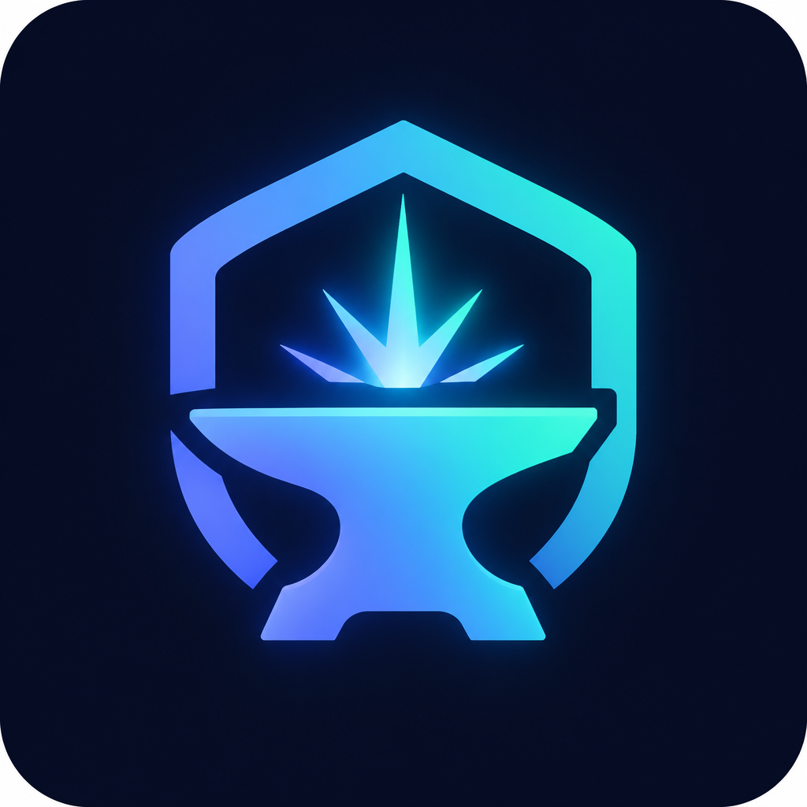
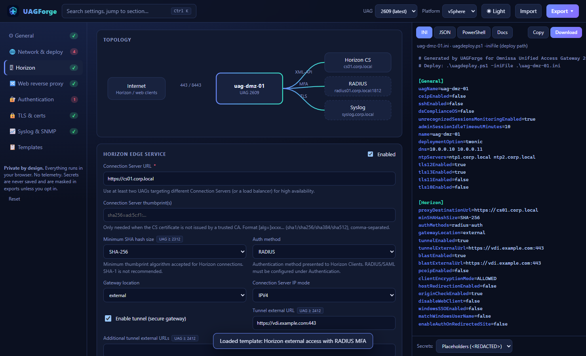
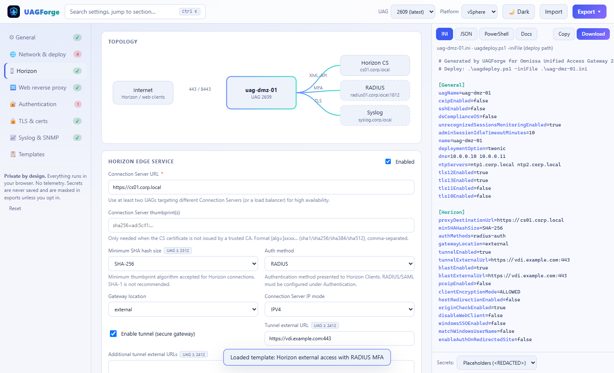
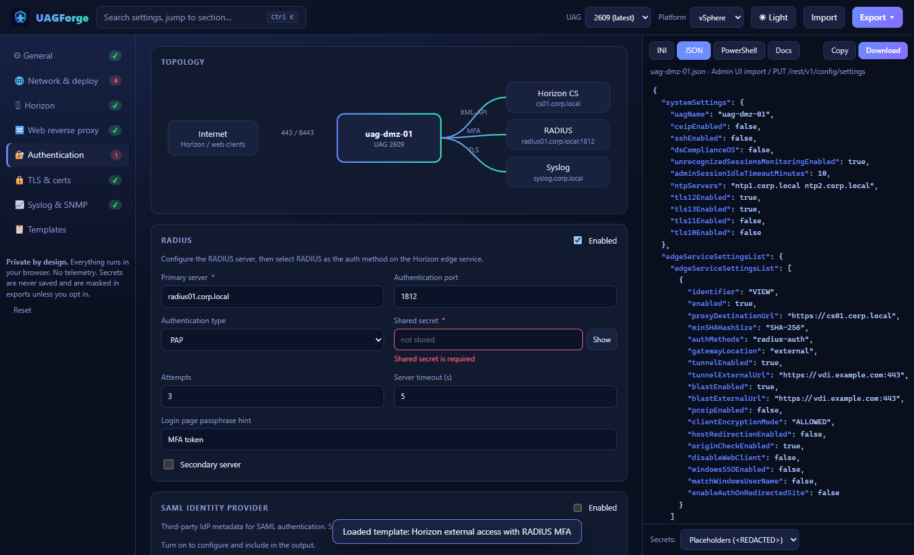
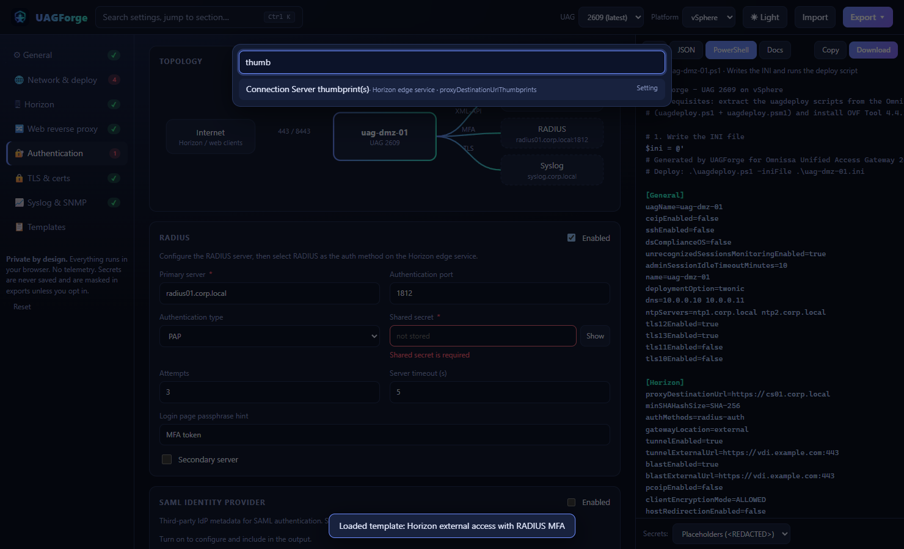
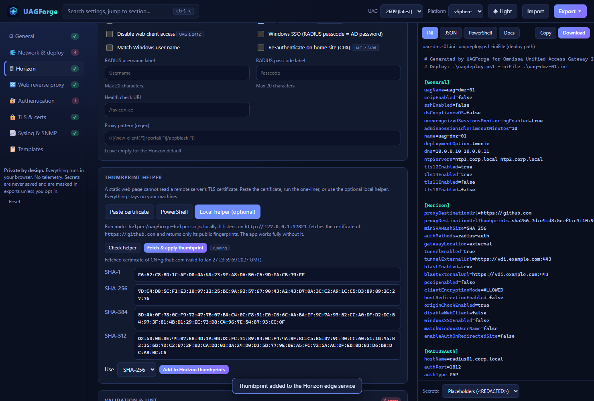
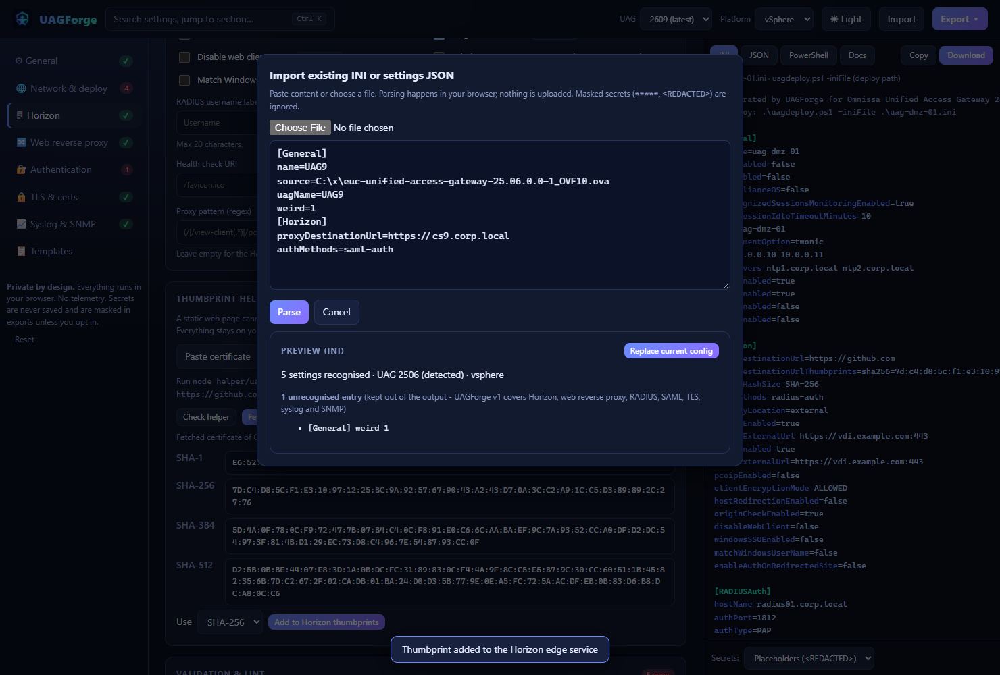

<p align="center">
  
</p>

<h1 align="center">UAG Forge</h1>
<p align="center">Visual config builder for <strong>Omnissa Unified Access Gateway (UAG)</strong> - generates <code>uagdeploy</code> INI, settings JSON and PowerShell. 100% client-side.</p>



## 🚀 Demo

A live demo is available at **[uag-forge.omnissa.graa.dev](https://uag-forge.omnissa.graa.dev)** - everything runs in your browser, nothing is uploaded.

## ✨ Features

- 📄 **INI for `uagdeploy.ps1`** (the primary deploy path - the script takes an INI via `-iniFile`, not JSON) **and settings JSON** for the admin UI *Import settings* / `PUT /rest/v1/config/settings`.
- 💻 **PowerShell output** that writes the INI and runs `uagdeploy.ps1` (vSphere), `uagdeployhv.ps1` (Hyper-V) or `uagdeployaz.ps1` (Azure), interactive or non-interactive.
- 🧬 **Version-aware form** driven by a data-driven schema ([`src/lib/schema.ts`](src/lib/schema.ts)): fields appear/disappear per UAG version and platform.
- 🎯 **Scope:** Horizon and Web Reverse Proxy edge services; RADIUS, SAML, OpenID Connect, RSA SecurID and certificate authentication; TLS protocols/ciphers/certificates, outbound proxy, syslog (UDP/TCP/TLS/MQTT) and SNMP (v1/v2c/v3). Platforms: vSphere, Hyper-V, Azure. OIDC, SecurID, certificate auth and outbound proxy are emitted to the INI only (their JSON shape is not documented).
- 🪜 **Cascading (double DMZ):** pick *Outer UAG* or *Inner UAG* under Horizon. The outer UAG is generated as a Horizon-WRP reverse proxy (documented proxy pattern, inner UAG URL/thumbprint) plus optional orwardrules for Blast/UDP tunnel/PCoIP; the inner UAG is a standard Horizon edge. Two ready-made templates are included. (Workspace ONE Tunnel cascade mode is not covered.)
- 📥 **Import** an existing INI or settings JSON (paste or file) with a preview of what was recognised/ignored; the UAG version is detected from the image file name.
- ✅ **Validation + best-practice lint** (required fields, IPv4/URL/port/thumbprint formats, RADIUS timing, duplicate IPs, TLS 1.0/1.1, SSH, missing syslog/NTP, no MFA on an external gateway, SHA-1 thumbprints …). Click a finding to jump to the field.
- 🗺️ **Topology diagram** that updates live, 📋 **templates** (e.g. *Horizon external access with RADIUS MFA*), 📝 **Docs** tab (Markdown runbook summary), ⌨️ **command palette** (<kbd>Ctrl</kbd>/<kbd>⌘</kbd>+<kbd>K</kbd>).
- 🌗 **Light/dark theme** - follows `prefers-color-scheme` by default, your choice is remembered.
- 🔑 **Thumbprint helper** - see below.

| Light theme | RADIUS & validation |
| --- | --- |
|  |  |
| **JSON output** | **Command palette** |
|  |  |
| **Thumbprint helper** | **Import** |
|  |  |

## 🛡️ Supported UAG versions

UAG Forge supports every UAG release that is **not end-of-life** according to the [Omnissa Lifecycle Matrix](https://docs.omnissa.com/bundle/Product-Lifecycle-Matrix/page/lifecyclematrix.html) (snapshot **2026-10-30**; UAG inherits the lifecycle of the product it is integrated with):

`2212 · 2303 · 2306 · 2309 · 2312 · 2406 · 2412 · 2503 · 2506 · 2512 · 2603 · 2606 · 2609`

2209 and older are no longer listed and are intentionally not offered. The list lives in [`src/lib/versions.ts`](src/lib/versions.ts) - update it when the matrix changes. Maintenance releases (e.g. `2509.1`) use the schema of their parent release.

Per-version field availability (`since` in the schema) was derived by diffing the published *Deploying and Configuring UAG* INI/Horizon reference pages of each release (2212 → 2609), e.g. `headersToBeLogged`/`minSHAHashSize` (2312), `enableAuthOnRedirectedSite`/`unrecognizedSessionsMonitoringEnabled` (2406), additional Blast/Tunnel external URLs and `disableWebClient` (2412), `originCheckEnabled` (2503), SAML IdP binding keys (2603). Treat gating as best-effort: Omnissa's pages reorganised over time, so a key may exist slightly earlier than the page first lists it.

## 🧭 Using it

1. Pick the **UAG version** and **platform** (vSphere, Hyper-V, Azure) in the header - or start from a **template**, or **Import** an existing INI/JSON.
2. Fill in the sections. Required fields and lint findings are flagged inline and in the *Validation & lint* panel.
3. Take the result from the right-hand panel: **INI**, **JSON**, **PowerShell** or **Docs**; *Copy* or *Download* (also in **Export**).
4. Deploy: `.\uagdeploy.ps1 -iniFile .\uag-dmz-01.ini` (you are prompted for the root and admin passwords; the PowerShell tab also shows the non-interactive form `-rootPwd … -adminPwd …`).

### 📚 Where do the key names come from?

INI section and key names (`[General]`, `[Horizon]`, `[RADIUSAuth]`, `[SnmpSettings]`, `[SyslogServerSettingsN]`, `[WebReverseProxyN]`, `[IDPExternalMetadata1]`, `[SSLCert]`, `[Azure]`) were taken from the official Omnissa documentation - *Run PowerShell script to deploy* (sample INI), *PowerShell deployment parameters*, *Configure Horizon Settings*, the vSphere/Hyper-V/Azure deployment pages and *Non-Interactive mode deployment parameters*. Keys whose name is only inferred from a documented pattern (secondary RADIUS server `hostName_2`/`sharedSecret_2`) carry a **verify** badge in the UI; the SNMPv3 *security level* token is free text because the docs do not list the INI values.

### 🧾 Settings JSON - read this

Omnissa documents the JSON as an *export/import format* of the admin UI but does not publish a schema page; the authoritative schema is the Swagger UI on your appliance (`https://<uag>:9443/swagger`). UAG Forge mirrors the admin-UI export structure (`systemSettings`, `edgeServiceSettingsList`, `authMethodSettingsList`, …) and uses the same key names as the INI. Deploy-time-only values (VM name, networks, IPs, certificate file paths …) are intentionally **not** part of the JSON. **Validate JSON on a non-production appliance first**, and prefer exporting a baseline from your own UAG and using *Import* here to compare.

## 🔒 Security & privacy

- Everything runs in your browser. **No telemetry, no network calls** (the only optional one is to a helper on `127.0.0.1` that *you* start).
- Secrets (RADIUS shared secrets, SNMP community/passwords) are **masked in the form**, **never saved** in the browser draft, and exported as `<REDACTED>` placeholders by default. Choose *Omit entirely* or *Include (plain text)* under the output panel. UAG root/admin passwords are never asked for - `uagdeploy` prompts for them.
- The form state (minus secrets) is kept in `localStorage` so a refresh does not lose work; use **Reset** to clear it.
- Certificates are referenced by *file path* (read by `uagdeploy` at deploy time); certificate or key content is never stored.

## 🔑 Thumbprint helper

A static web page **cannot** open a TLS connection to read a remote server's certificate, so the Horizon *Connection Server thumbprint* field offers three routes (Horizon → *Thumbprint helper*):

1. **Paste a PEM/DER certificate** (or load a file). SHA-1/256/384/512 are computed locally with WebCrypto and can be added as `sha256=aa:bb:…`.
2. **PowerShell one-liner** - copy and run it on any host that can reach the Connection Server; it prints all four thumbprints.
3. **Optional local helper** ([`helper/uag-forge-helper.mjs`](helper/uag-forge-helper.mjs)) - a ~100-line, dependency-free Node script. Start it with `node helper/uag-forge-helper.mjs`; when it is running the app detects it and can fetch and apply the thumbprint with one click.

   - Listens only on `http://127.0.0.1:47821`; rejects unexpected `Host` headers (DNS rebinding); answers only browsers from `localhost`, `*.github.io`, `uag-forge.omnissa.graa.dev` or an origin you pass with `--origin https://your-host` (`--port` changes the port).
   - Endpoints: `GET /ping` and `GET /thumbprint?host=cs01.corp.local&port=443`. It returns only the certificate's public fingerprints and subject; it stores and logs nothing.
   - The app works fully without it. (Safari blocks `https` pages talking to `http://127.0.0.1`; use the paste or PowerShell route there.)

## 🛠️ Develop

```bash
npm install
npm run dev       # http://localhost:5173
npm test          # Vitest: generation, import/parsing, validation, thumbprints
npm run check     # svelte-check / TypeScript
npm run build     # static site in dist/ (relative base - host it anywhere)
```

Stack: Vite + Svelte 5 + TypeScript. Layout:

| Path | Purpose |
| --- | --- |
| `src/lib/schema.ts` | Data-driven field schema (INI key, JSON key, version/platform gating, validation rules) |
| `src/lib/generate.ts` | INI + JSON generation, secret handling |
| `src/lib/importer.ts` | INI/JSON parsing and mapping back onto the schema |
| `src/lib/validate.ts` | Field validation and best-practice lint |
| `src/lib/thumbprint.ts` | WebCrypto thumbprints, PowerShell one-liner, helper client |
| `src/lib/templates.ts` | Ready-made designs |
| `src/components/` | Svelte UI |
| `helper/` | Optional localhost helper |

### 🧩 Adding a setting

Add a `Field` to a group in `schema.ts` (key, type, optional `since`/`until`, `rule`, `showIf`). The form, INI/JSON output, import mapping, validation and command palette pick it up automatically. See [CONTRIBUTING.md](CONTRIBUTING.md).

### 🌐 Hosting

The demo is deployed to GitHub Pages by [`.github/workflows/pages.yml`](.github/workflows/pages.yml) on every push to `main`. The build is a plain static site with a relative base path, so `dist/` can be hosted anywhere. A weekly workflow checks the Omnissa Lifecycle Matrix and opens an issue when the supported UAG versions change.

## 📄 License

[MIT](LICENSE)

## ⚠️ Disclaimer

UAG Forge is an independent community tool and is not affiliated with or endorsed by Omnissa. Always review generated configuration before deploying to production.
